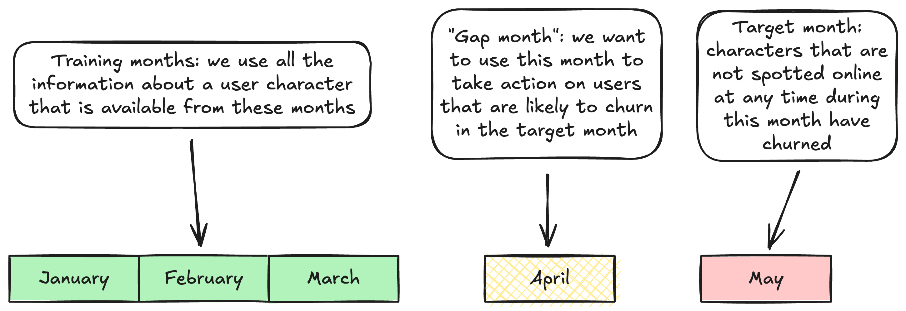
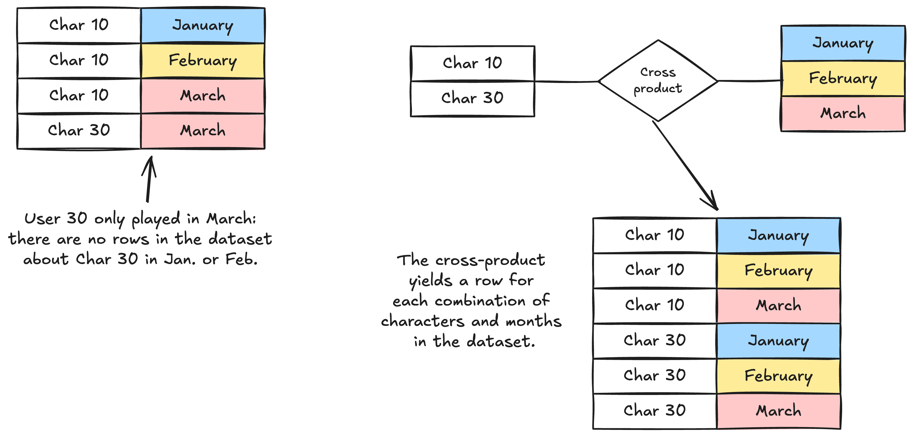
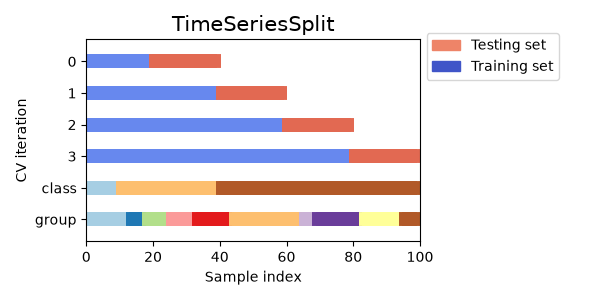
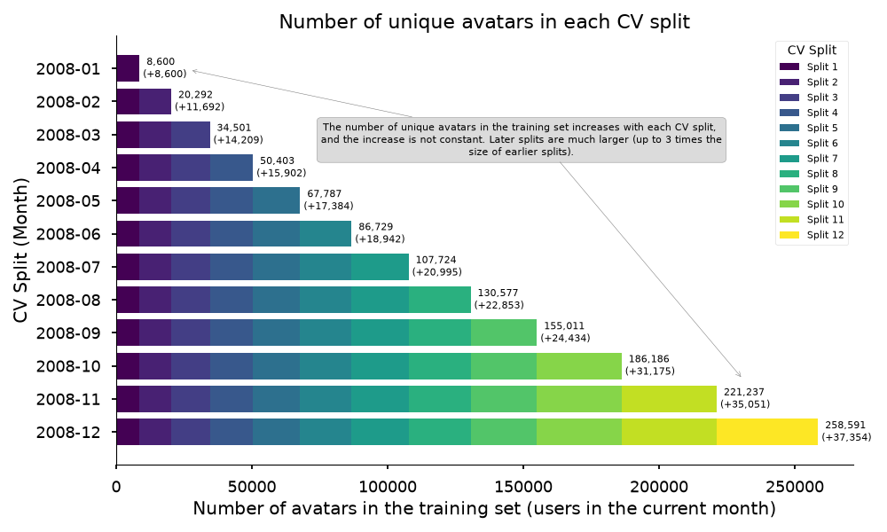

```{python}
#| echo: false
import inspect
from IPython.display import Markdown, display


def show(*objs):
    """Display the source code of the repository functions used in this post."""
    src = "\n\n".join(inspect.getsource(o) for o in objs)
    display(Markdown(f"```python\n{src}\n```"))
```

In this blog post we will see how we can predict player churn in World of Warcraft 
(WoW), a subscription-based MMORPG that was released in 2004. More precisely, we are 
interested in predicting a player's behavior in a given month, and decide whether 
there is a risk that they will stop playing the next month. 
To do so, we want to train a machine learning model that, given features based 
on each player and on the overall playerbase, will be able to predict whether 
player X will stop playing in a given month. 

Through the post we will build a full machine learning pipeline: we use  
polars for dataframe operations; [skrub](https://skrub-data.org/stable/) is used
for data exploration, feature engineering and constructing the overall execution plan; 
scikit-learn is imported for the actual ML model; hyperparameter optimization is 
done using Optuna through skrub's Data Ops. 

To keep the focus of this post on the process rather than the code, most of the 
lower-level functions will be hidden in collapsible blocks. This includes much 
of the pre-processing and feature engineering, although important sections will
be highlighted as needed. Additionally, some detail on the implementation will
be omitted from this writeup; for detailed comments and rationale on the code
refer to the [repository](https://github.com/rcap107/wowah-sessionization).

### The dataset
We rely on the [World of Warcraft Avatar History](https://qualinet.github.io/databases/world_of_warcraft_avatar_history_dataset/). 
The dataset is built by scanning the game's servers roughly every 10 minutes, and
logging information about each **user character** in the Horde faction that is
found online at the timestamp's time. As we have a sequence of timestamps, this
lets us track the behavior of players over time. 


::: {.callout-important}

### Characters and avatars
Through this write-up, we will use the terms "character" and "avatar" interchangeably:
both terms will be used to refer to any single player-controlled character that 
is found online when the server snapshot is taken. 

:::


Avatar information includes:

- The avatar's ID (a unique integer ID for anonymization)
- The ID of the avatar's guild (possibly missing)
- The avatar level at that moment in time
- The avatar's race (Blood Elf, Undead, Tauren etc.)
- The avatar's class (Hunter, Mage, Warlock etc.)
- The avatar's location in the game's world

**Practical observations** 
The dataset requires some preprocessing before it can be converted to a dataframe, 
as it is stored in plaintext in a non-standard format. We handle the conversion
procedure in a [separate script](https://github.com/rcap107/wowah-sessionization/blob/main/src/parse_to_single_table.py),
so that the rest of the process can use dataframe libraries. We also upload the processed 
dataset on 
[Kaggle: World of Warcraft Avatar History 2006-2009](https://www.kaggle.com/datasets/ryye107/world-of-warcraft-avatar-history).

### A quick exploration of the dataset
We begin by loading the historical dataset with all the timestamps. To keep the
examples fast, this post uses the year 2008 (about 10.8M rows, 37k characters); the
repository can also run everything on the full 2006-2009 dataset (35.6M rows, 90k
characters). We use 
`.scan_parquet()` because it returns a `LazyFrame`, which we want to use as much
as possible through the code for query optimization. 

```{python}
from skrub import TableReport
import polars as pl

df = pl.scan_parquet("data/wowah_data_2008.parquet")
# we collect the dataframe because the TableReport does not accept LazyFrames
TableReport(df.collect())
```

Skrub's `TableReport` gives a quick view of many statistics we may be interested
in when we explore a dataset. 
We can get information on the shape of the dataframe (almost 11M rows), the 
data types we are working with as well as the distribution of categorical and 
numerical values. The level cap of 70 is immediately evident as the median of the 
"level" column.

By itself, this dataset includes a wealth of information about player habits and 
behaviors, but exploring such information goes beyond the scope of this post. As
such, we will only focus on what is most relevant to the task of predicting player
churn. 


## Modeling player churn
Modeling user churn is a common application of machine learning models, though 
the definition of churn is typically business' specific. In general, by "user churn"
one refers to "a user that does not come back to the service". In the context of 
this example, churn refers to **those characters that are not found online after
a certain amount of time**, and that suspended their subscription.  
As we do not have access to the actual subscription data, we assume that a player 
has suspended their subscription when they stop playing for **two consecutive 
months**. A single missing month is more likely a break than a cancellation, so
a character that skips a month and then comes back is not considered churned. 

For this post, we aggregate player behaviors at a monthly basis, and add a `has_played`
flag that tells us if a player has played at least once during each month. From it, 
we derive two columns:

- `churn`: the character has *churned as of this month*, i.e., `has_played` is `False` 
  both in this month and in the previous one.
- `churn_next`: the value of `churn` in the *following* month. This is the target 
  that we want to predict.


::: {.callout-important}

**Our objective**

Given a month (e.g., June), we want to use all the data up to the last day of the 
previous month (all months until May included) to predict whether a user will have 
churned as of July (i.e., their `has_played` flag will be `False` both in June and 
in July).

:::



The idea is that, by knowing that user X is likely to churn, we should be able to 
use the month of June to apply some incentive to the user so they won't churn. 
Note that, in the diagram, a character that is absent in the target month has only
churned if it was also absent in the "gap month".

::: {.callout-warning}
#### Why the target is shifted

It is tempting to use `churn` itself as the target of the June row. However, the 
features of the June row are built from May, and `churn` for June is only true if the 
character was absent in May: any character with activity in May would be labeled 
"not churned" by construction, and the model would learn that from the missing 
values alone. Cross-validation scores looked excellent (ROC AUC around 0.95) for 
the wrong reason. Shifting the target one month forward removes the shortcut.
:::

One caveat with this modeling strategy is that we are working with 
historical data, so we cannot actually apply said incentive and observe whether 
it has an impact like in a typical [A/B test](https://en.wikipedia.org/wiki/A/B_testing). 

### Building the churn dataset
We begin by adding two columns to the historical dataset: in the first we store 
each timestamp, truncated to have a monthly resolution; in the second we track the 
first month for each character. Additionally, we add a constant `has_played` column
that acts as our "player was seen" flag. 

We are interested in monthly snapshots, so the dataset is then reduced to select
only the unique (character, month) pairs. 

::: {.callout collapse="true"}
#### Data preparation (click to expand)

```{python}
#| echo: false
from add_churn import make_data
show(make_data)
```

```{python}
data = make_data(df)
```

:::

Since we want to predict the behavior a player will have over a single month, our
target variable will be grouped by "user-month" (e.g., `ID153_2026-12`). However, 
not all players will play at least once every month, so by relying exclusively 
on the historical data we would be missing samples; to get around this problem 
we generate a `char_month` dataset that contains all unique combinations of users
and months by executing the cross-product between the unique users and the range
of months. 



::: {.callout collapse="true"}

### Cross product (click to expand)

The cross product between two sets (in this case, months and unique users) 
builds a new set where each element in the first set is paired with all elements
in the second set. 

```{python}
import polars as pl
df1 = pl.DataFrame({"col": [1,2,3]})
df2 = pl.DataFrame({"col": ["a","b"]})
df1.join(df2, how="cross")
```

:::

::: {.callout collapse="true"}
#### Generate all unique combinations of users and months (click to expand)

```{python}
#| echo: false
from add_churn import make_user_month
show(make_user_month)
```

```{python}
user_month = make_user_month(df)
user_month.collect()
```

:::


The grid extends three months past the end of the data. These extra months only 
exist so that lagged features can be computed on months without data, and the 
rows are dropped later because their target is unknown.

Now that we have all the combinations (character, month), we can join back the 
prepared data to mark all the months in which each character was found online, 
and marking all others with `has_played=False`. 

Additionally, the resulting rows are filtered to remove all pairs (char, month) 
whose `month` precedes the character's first month. We should not have a row 
about a character's playtime in January if they started playing in August! 

Then we add the churn information. After sorting by month, `prev_played` is the 
`has_played` flag of the previous month for the same character (`False` for the 
first month), `churn` marks the characters absent in both months, and `churn_next` 
is `churn` shifted one month back within each character. The last month in the data 
has no "next month" to look at, so its `churn_next` is left empty. 


::: {.callout collapse="true"}
#### Add the churn columns (click to expand)
```{python}
#| echo: false
from add_churn import add_churn
show(add_churn)
```

```{python}
r = add_churn(user_month, data)
r.collect()
```

:::

Finally, we can put everything together in a single function that takes the 
historical data as input and returns a dataset with the churn indication as output. 
It also calls `remove_unrealistic_entries`, a safety check that removes the rows 
preceding a character's first month and selects the final columns. Rows without 
a target are dropped, since they can be used neither for training nor for evaluation:

```{python}
#| echo: false
from add_churn import build_churn_dataset, remove_unrealistic_entries
show(build_churn_dataset)
```

```{python}
churn_data = build_churn_dataset(df)
churn_data
```

This dataframe contains a row for each (character, month) starting from that 
character's first month up until the second-to-last month of the dataset. In each 
row, `has_played` informs us of whether the character logged in at any time in that 
month, and `churn_next` is the target that we want to predict on a monthly basis. 

## Setting up the ML pipeline
Before starting with feature engineering and actually training the model, it's 
worth spending some time understanding the scenario we are in. 

The main factor that complicates this scenario is the fact that we are dealing
with sequential data points, which are therefore not independent of each other: 
the position of a player at a time T is strongly correlated with their position
at time T+1. 

### Building a custom splitter
For this reason, we need to use a splitter that returns sequential splits. A 
common example of this is scikit-learn's
[TimeSeriesSplit](https://scikit-learn.org/stable/modules/generated/sklearn.model_selection.TimeSeriesSplit.html). `TimeSeriesSplit` works by splitting the entire dataset in a given number 
of splits; during cross-validation, at step K the splitter returns the first k
splits as the train split, and the k+1 split as the validation split. 

{fig-align="center"}

[Source](https://scikit-learn.org/stable/auto_examples/model_selection/plot_cv_indices.html#sphx-glr-auto-examples-model-selection-plot-cv-indices-py)

A downside of `TimeSeriesSplit` is that the splitter assumes uniformly distributed
samples, so that each singular split has the same size as the others. This is a 
problem for our scenario: our samples are (character, month) pairs, and the number
of characters in each month is never constant and indeed increases over time: 

{fig-align="center"}

For this reason, we need to define a custom splitter that is aware of the constraints
we are working with. Given that we are working month-by-month, each split should
contain all the characters that played in a specific month, and should be able to
do so regardless of the fact that the number of characters changes.

There is a second constraint: the target of a row is the churn status of the 
*following* month, so it is only known one month later. If the training set included 
the rows of the month right before the test month, their targets would be computed 
from the activity in the test month. The splitter therefore leaves a one-month gap 
between the last training month and the test month.

This is what we implement here: 

```{python}
#| echo: false
import main

display(Markdown(
    f"The boundaries of the experiment are defined in `main.py`: split points go "
    f"from {main.MIN_DATE:%Y-%m-%d} to {main.MAX_DATE:%Y-%m-%d}, and each test "
    f"month is the one following its split point. The last test month is "
    f"the latest one whose target is fully observed."
))
```

```{python}
#| echo: false
from main import Splitter
show(Splitter)
```

Like all other scikit-learn splitters, our splitter is a generator that, given 
X and y (`user_month` and the target in our case), returns the indices of the 
samples that should be used in each split. 

## Building the pipeline

### Generating the features
The features of a row at month M are computed from the activity of month M-1 only. 
They fall in a few groups:

- fixed attributes of the character: race and class;
- **session features**: skrub's `SessionEncoder` groups consecutive heartbeats of a 
  character into sessions, which gives the number of sessions in the month, and the 
  total, average and standard deviation of their duration, and the average start 
  and end time;
- **player features**: highest level, number of distinct zones and guilds, most 
  frequent zone, first and last guild;
- **playerbase features**: average level and number of active players of the 
  character's class;
- optionally, **location features**: how rare the zones visited by the character 
  are, how much time is spent in "hub" zones that everyone visits, and how evenly 
  the time is spread across zones (Gini coefficient);
- **lagged features**: the value of every feature one or more months earlier, 
  plus the month-to-month difference of numeric features, so that the model can 
  see trends.

The functions that compute them live in 
[adding_features.py](https://github.com/rcap107/wowah-sessionization/blob/main/adding_features.py).
The function below loops over the months, and for each one filters the historical 
data down to the previous month before building the features. Because lagged features 
need each character's complete timeline, the feature table is built once for every 
(character, month) pair, independently of the cross-validation split, and each split 
only selects its rows from it.

::: {.callout collapse="true" }
#### Full feature engineering function (click to expand)
```{python}
#| echo: false
from main import filter_df_by_month, build_feature_table, add_features
show(filter_df_by_month, build_feature_table, add_features)
```

:::

### Putting everything together in a Data Op


::: {.callout-tip collapse="true"}
#### Loading and downsampling the file (click to expand)
The dataset is very large, so we downsample it to reduce the execution time. 
Note that we need to be deliberate with how we sample the data: rather than choosing
a random subset of the values in the dataset, we need to be careful to select a
subset of characters and keep all the rows for those characters. This ensures that 
we have reliable information about all the characters. 

```{python}
#| echo: false
from main import load
show(load)
```

:::

The hyperparameters of the pipeline are declared with skrub's `choose_*` functions: 
the session gap, whether to use location features, how many lags to add, and the 
learning rate of the model. They can then be tuned together with the rest of the plan.

::: {.callout-tip}

#### Full Data Op construction script 
```{python}
#| echo: false
from main import make_data_op
show(make_data_op)
```

:::

### Running it
The data op is evaluated by passing the path of the parquet file as input. Here we 
cross-validate it on 10% of the characters of the 2008 data:

```{python}
#| eval: false
data_op = make_data_op(load_fraction=0.1)
results = data_op.skb.cross_validate(
    environment={"historical_data_file": "data/wowah_data_2008.parquet"}
)
```

The ROC AUC of each test month (March to November 2008, with default hyperparameters; values change by a few hundredths between runs) is:

| Mar | Apr | May | Jun | Jul | Aug | Sep | Oct | Nov |
|---|---|---|---|---|---|---|---|---|
| 0.50 | 0.52 | 0.75 | 0.81 | 0.83 | 0.84 | 0.80 | 0.86 | 0.84 |

The first folds are close to chance because there are only a few months of training 
data, and the playerbase is small. Scores improve as more history becomes available. 
These are not tuned results: the point of this post is the structure of the pipeline.

::: {.callout-note}
The evaluation includes characters that were already absent in the previous month: 
predicting that they will remain absent is easy. A stricter evaluation would only 
score the characters that were still active, which are the ones that could 
actually be retained.
:::
