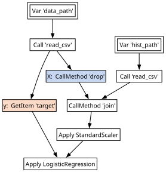
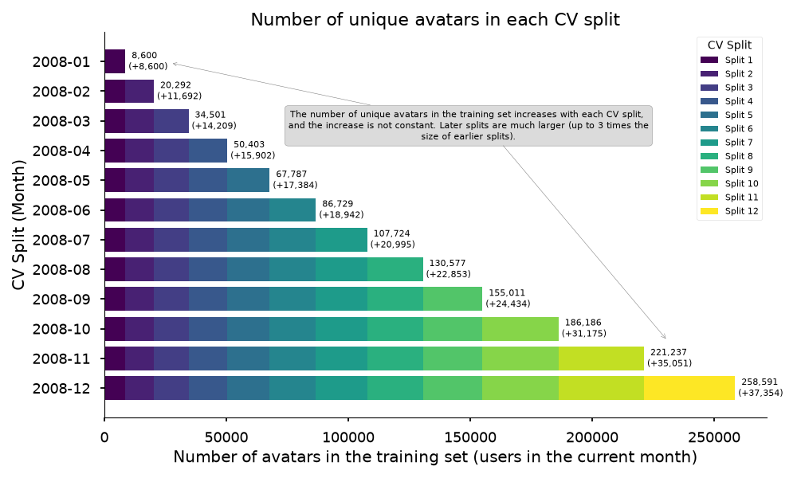

## Skrub {.smaller}

Machine learning on tabular data

{width="70%" style="margin-bottom: -1rem;"}

{width="60%" style="margin-bottom: -1rem;"}

::: {.incremental}
- [skrub-data.org](https://skrub-data.org)
- This talk: the [skrub DataOps](https://skrub-data.org/stable/data_ops.html) framework.
:::

# Act 1: skrub Data Ops

## {.smaller}

:::: {.columns}

::: {.column width="44%"}

**Textbook ML**


<br>

$X \in \mathbb{R}^{n \times p},\ y \in \mathbb{R}^n$

$\hat{y} = f_{\hat{\theta}}(X)$

<br>

::: {.fragment}


```{=html}
<pre><code class="language-python">estimator = <span style="outline: 3px transparent; outline-offset: 1px;">TabICLRegressor()</span>

cross_validate(estimator, X, y)

estimator.fit(X_train, y_train)
estimator.predict(X_new)</code></pre>
```

:::


:::

::: {.column width="55%"}


::: {.fragment}

**Data-Science Practice**


:::


:::

::::

## {.smaller}

:::: {.columns}

::: {.column width="44%"}

**Textbook ML**

<br>

$X \in \mathbb{R}^{n \times p},\ y \in \mathbb{R}^n$

$\hat{y} = f_{\hat{\theta}}(X)$

<br>

```{=html}
<pre><code class="language-python">estimator = TabICLRegressor()

cross_validate(estimator, <span style="outline: 3px solid #2a52a8; outline-offset: 1px;">X</span>, <span style="outline: 3px solid #c04a10; outline-offset: 1px;">y</span>)

estimator.fit(X_train, y_train)
estimator.predict(X_new)</code></pre>
```
:::

::: {.column width="55%"}
**Data-Science Practice**


:::

::::

## {.smaller}

:::: {.columns}

::: {.column width="44%"}

**Textbook ML**

<br>

$X \in \mathbb{R}^{n \times p},\ y \in \mathbb{R}^n$

$\hat{y} = f_{\hat{\theta}}(X)$

<br>

```{=html}
<pre><code class="language-python">estimator = <span style="outline: 3px solid blue; outline-offset: 1px;">TabICLRegressor()</span>

cross_validate(estimator, X, y)

estimator.fit(X_train, y_train)
estimator.predict(X_new)</code></pre>
```
:::

::: {.column width="55%"}
**Data-Science Practice**


:::

::::


## 
To build a ML pipeline, we need to:

- preprocess the data, perform feature engineering, train a model ... 
- so we need to [**learn a state**]{style="color: #1a5a8a; font-weight: bold;"}... 
- while we [**evaluate the predictive performance**]{style="color: #1a5a8a; font-weight: bold;"}... 
- as we avoid [**data leakage**]{style="color: #1a5a8a; font-weight: bold;"}... 
- with multi-source input ... 

How do we deal with that? 

## With Data Ops... {.smaller}

- Cross-validate without [**data leaks**]{style="color: #1a5a8a; font-weight: bold;"}: `fit()` on training
and `predict()` on unseen data. 
- [**Tune choices**]{style="color: #1a5a8a; font-weight: bold;"} with hyperparameter tuning and validation scores.
- Replay on [**new inputs**]{style="color: #1a5a8a; font-weight: bold;"}.
- **Arbitrary data processing** and data wrangling with sample filtering, joins and aggregations, multiple inputs and dynamic arguments.
- **Inspect** the pipeline step-by-step, **persist** the source code that generates a model.

## Basic example {.smaller auto-animate="true"}


::: {.columns}

::: {.column width=60%}


::: {.fragment fragment-index=1}

Declare the pipeline

```{.python code-line-numbers="|1-2|3|4-5|6|7-9|"}
data_path = skrub.var("data_path")
data = data_path.skb.apply_func(pd.read_csv)
hist = skrub.var("hist_path").skb.apply_func(pd.read_csv)
X = data.drop(columns="target", errors="ignore").skb.mark_as_X()
y = data["target"].skb.mark_as_y()
X_join = X.merge(hist, on="id", how="left")
pred = X_join.skb.apply(
    StandardScaler()
).skb.apply(LogisticRegression(), y=y)
```


:::


::: {.fragment}

Cross-validate

```{.python code-line-numbers="|2|"}
pred.skb.cross_validate(
    environment={"data_path": "historical_data.csv", "hist_path": "archive.csv"}
)
```

:::


::: {.fragment}


Make a "learner" (object with `fit()` & `predict()`)

```{.python code-line-numbers="|2|3|5|6|"}
learner = pred.skb.make_learner(
).fit(
    environment={"data_path": "historical_data.csv", "hist_path": "archive.csv"}
)
learner.predict(
    environment={"data_path": "new_data.csv", "hist_path": "archive.csv"}
)
```


:::


:::

::: {.column width=40%}


::: {.fragment fragment-index=2}



:::


:::

:::


# Act 2: Dataset and problem

## What are we here for?  {.smaller}
- **The dataset**: World of Warcraft Avatar history Dataset [^1]
  - World of Warcraft is a **subscription-based** online videogame.
  - The dataset collects player activity over 2005-2009.


::: {.fragment}


- **The problem**: Some players eventually stop playing, and thus stop paying
their subscription.
  - A player **churns** if they have **no activity** for two full months. 
  - We want to predict which players are likely to churn in the next month, in
order to enact some measure to keep them from leaving. 

:::

::: {.fragment}

- Our "unit of analysis" is a (player character, month) pair. 
- Each pair tells us whether the given player character played on the given month.


:::

[^1]: [Source](https://web.cs.wpi.edu/~claypool/mmsys-dataset/2011/wow/)


## The game {.smaller}

::: {.columns}

::: {.column}

- World of Warcraft (WoW) is MMORPG released in 2004 by
Blizzard Entertainment. 
- Players create **character avatars** to navigate the open game world
and perform various activities. 
- Players level up their characters to make them more powerful. 
- A single player may have **multiple avatars**. 

:::

::: {.column}


:::

:::


## World of Warcraft Avatar history {.smaller}

- ~35.6M timestamped "character is active" lines (**heartbeats**). 
- Time range: 2005-12-31 / 2009-01-10 in the 
**Taiwanese server**.
- Two expansions are included in the range:
  - The Burning Crusade (April 2007)
  - Wrath of the Lich King (November 2008).  


## Raw data structure {.smaller}


::: {.columns}

::: {.column}

**Folder structure**

```
WoWAH
├── 2006_01_03
│   ├── 2006-01-01
│   │   ├── 00-03-56.txt
│   │   ├── 00-13-43.txt
│   │   ├── 00-23-48.txt
│   │   ├── 00-33-48.txt
│   │   ├── ...
│   ├── 2006-01-02
│   ├── ...
├── 2006_04_06
├── ...
```


:::

::: {.column}

**Content of a single log file**

```
# head WoWAH/2006_01_03/2006-01-01/00-03-56.txt 
Persistent_Storage = {
	[1] = "0, 12/31/05 23:59:46, 1,0, , 5, Orc, Warrior, Durotar, no, 0",
	[2] = "0, 12/31/05 23:59:46, 1,1, , 9, Orc, Shaman, Durotar, yes, 0",
	[3] = "0, 12/31/05 23:59:52, 2,2, , 13, Orc, Shaman, Durotar, no, 0",
	[4] = "0, 12/31/05 23:59:52, 2,3,0, 14, Orc, Warrior, Durotar, no, 0",
	[5] = "0, 12/31/05 23:59:52, 2,4, , 14, Orc, Shaman, Durotar, yes, 0",
	[6] = "0, 12/31/05 23:59:52, 2,5, , 16, Orc, Hunter, The Barrens, yes, 0",
	[7] = "0, 12/31/05 23:59:52, 2,6, , 18, Orc, Warlock, The Barrens, no, 0",
	[8] = "0, 12/31/05 23:59:52, 2,7, , 17, Orc, Hunter, Silverpine Forest, yes, 0",
...
```


:::

:::

## The dataset: some statistics {.smaller}


## Feature engineering {.smaller}

- Session-based features (`skrub.SessionEncoder`)
  - Number of sessions, duration, distribution during the day... 
- Monthly aggregates 
  - Statistics by class, race, overall playerbase...
- Location-based features
  - Zone rarity, where players spend their time
- Lagged features 
- `skrub.TableVectorizer` to encode 

More detail about feature engineering and model selection is available in the full technical report. 

## Model selection

- `HistGradientBoostingClassifier` (HGBC) as the evaluation model
- Month-by-month temporal CV
- Hyperparameter tuning with Data Ops


## Caveats
- While we are interested in **players**, we have information only about their 
**avatars**. A player may stop playing with an avatar, but keep paying the subscription. 
- As this is past data, we cannot actually evaluate the effectiveness of whatever
measure we decide to implement, so we can only try to **predict player behavior**. 


# Act 3: The implementation

## What is this section for?

- The implementation involved a number of **pain points** that Data Ops simplified.
- We focus on some of the main issues without discussing the entire implementation here


## Pain point 1 - Data preparation is part of the pipeline {.smaller}

- Data is not clean: heartbeats are in text files scattered over hundreds of folders
rather than in a more manageable format. 
- The same transformations (and all other **learned states**) need to be replayed
on new data. 
- Boilerplate code and pre-processing scripts are brittle and prone to errors.


## Pain point 1 - Data preparation is part of the pipeline {.smaller}


::: {.columns}

::: {.column width="60%"}

**Building the pipeline**

```{.python code-line-numbers="|2|3|5-7|9-10|12-13|14|15|"}
def make_data_op():
    raw_files = skrub.var("raw_files")
    historical_data = raw_files.skb.apply_func(load)

    user_month_has_played = historical_data.skb.apply_func(
        build_churn_dataset
    ).skb.set_name("query")
    
    X = user_month_has_played["char", "month"].skb.mark_as_X(...)
    y = user_month_has_played["churn_next"].skb.mark_as_y()

    feature_table = historical_data.skb.apply_func(build_feature_table)
    encoded = feature_table.skb.apply(skrub.TableVectorizer())
    data_op = encoded.skb.apply(HGBC(), y=y)
    return data_op

```

:::

::: {.column width="40%"}


::: {.fragment}


**Exporting the learner**

```{.python}
...
data_op, X = make_data_op()
learner = data_op.skb.make_learner()
learner.fit(get_env("train"))

unseen_env = get_env("unseen")
predictions = learner.predict(unseen_env)
...
```

:::

:::

:::


## Pain point 2 — Time-aware cross-validation {.smaller auto-animate="true"}

::: {.columns}

::: {.column}

- Features and session aggregations must only use **data available at scoring time**
- Off-the-shelf `TimeSeriesSplit` assumes folds of **equal size**
- Here the number of (character, month) rows **grows every month** — folds are unbalanced by nature

:::

::: {.column}



:::

:::

## Pain point 2 — Time-aware cross-validation {.smaller auto-animate="true"}


::: {.columns}

::: {.column width=45%}


- Data Ops natively support  **custom splitters** for splitting data in the DAG.
- Custom splitters can use custom dataframe logic to select the samples
- Splitters plugged in `skb.mark_as_X(cv=Splitter())` are honored by 
`cross_validate`, `train_test_split`, randomized search, and scoring

:::

::: {.column width=55%}


```{.python}
class Splitter:
    def split(self, X, y=None):
        ...
        for split_point in ...:
            test_month = pl.Series([split_point]).dt.offset_by("1mo").first()
            train_idx = (
                X.with_row_index("idx")
                .filter(pl.col("month") <= split_point)["idx"]
            )
            test_idx = (
                X.with_row_index("idx")
                .filter(pl.col("month") == test_month)["idx"]
            )
```

:::

:::


## Pain point 3 — Tuning wrangling choices, not just model knobs {.smaller auto-animate="true"}

- Model choices are not limited to model hyperparameters: `session_gap` (15/30/60 min), include location features?, which lags?
- These are **data pipeline decisions**, with big performance and runtime impact
- Pipeline decisions **modify the pipeline itself**, and regular hyperparameter tuning does not work


## Pain point 3 — Tuning wrangling choices, not just model knobs {.smaller auto-animate="true"}
- **With DataOps** choices can be dropped inline, where the value is used — `choose_from`, `choose_bool`, `choose_float(log=True)`
- One call to `skb.make_randomized_search(backend="optuna", ...)` turns the whole DAG into a search 

## Pain point 3 — Tuning wrangling choices, not just model knobs {.smaller auto-animate="true"}
```{=html}
<ul style="font-size: 0.8em;">
<li>Replace any value with a choice:</li>
</ul>
<pre style="font-size: 0.55em; background-color: #f5f5f5; padding: 0.6em 1em; margin: 0.8em 0;"><code style="background-color: inherit;">X_enc = X.skb.apply_func(build_feature_table,
<span style="color: #c00; background-color: #fff0f0;">-    session_gap=<span style="background-color: #f9a0a0;">30</span>,</span>
<span style="color: #080; background-color: #f0fff0;">+    session_gap=<span style="background-color: #9be99b;">skrub.choose_from([15, 30, 60])</span>,</span>
 )
 pred = X_enc.skb.apply(HGBC(), y=y)</code></pre>
<ul style="font-size: 0.8em;">
<li>Tune data pipeline decisions, not only hyperparameters</li>
</ul>
<pre style="font-size: 0.55em; background-color: #f5f5f5; padding: 0.6em 1em; margin: 0.8em 0;"><code style="background-color: inherit;">X_enc = X.skb.apply_func(build_feature_table,
<span style="color: #080; background-color: #f0fff0;">+    additional_features=<span style="background-color: #9be99b;">skrub.choose_bool()</span>,</span>
 )
 pred = X_enc.skb.apply(HGBC(), y=y)</code></pre>
```

## Pain point 4 - Debugging and inspecting a pipeline
- Inspecting a regular pipeline is complex and requires programmatic access
- Once deployed, it is hard to maintain a trained model ("why was this step needed?", 
"where is the source code?")
- The result of intermediate steps is hard to access

## Pain point 4 - Debugging and inspecting a pipeline
- Data Ops reports provide rich information about each node
- The source code used to generate a Data Op is bundled with it
- When a preview or environment is provided, intermediate results can be shown

## Pain point 4 - Debugging and inspecting a pipeline

<iframe src="reports/execution_report/index.html" width="100%" height="480px" style="border: 1px solid #ccc; border-radius: 4px;"> </iframe>


# Conclusions

## What have we seen so far? {.smaller}

::: {.columns}

::: {.column}


- Data science is harder than what you learn in classes
- A full ML pipeline involves preprocessing, feature engineering and model training
- We want to learn a "state" (it's called machine **learning** after all), [**evaluate performance**]{.emph} and do so while avoiding [**data leakage**]{.emph}
- [**Data Ops**]{.emph} are a framework that allows to build [**stateful pipelines**]{.emph} for
[**arbitrary code and inputs**]{.emph}

:::

::: {.column}

TODO Repo QR code

:::

:::

