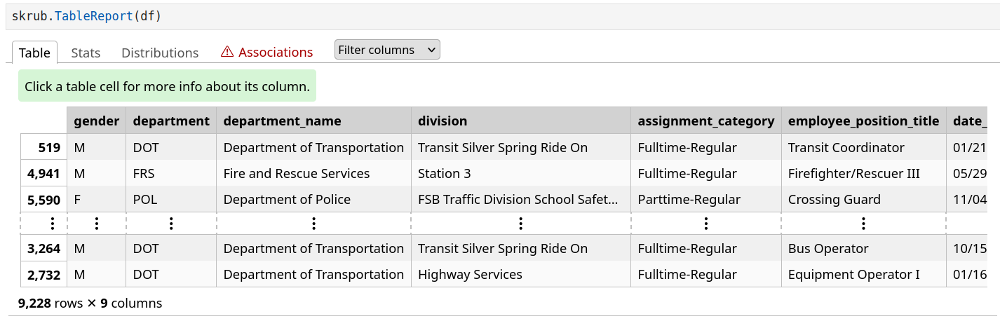
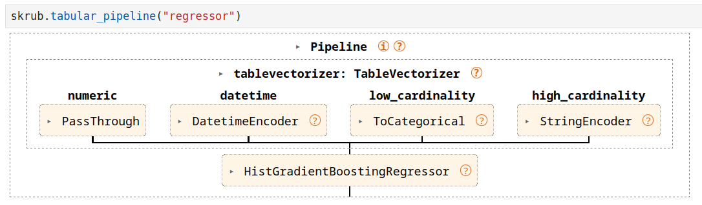
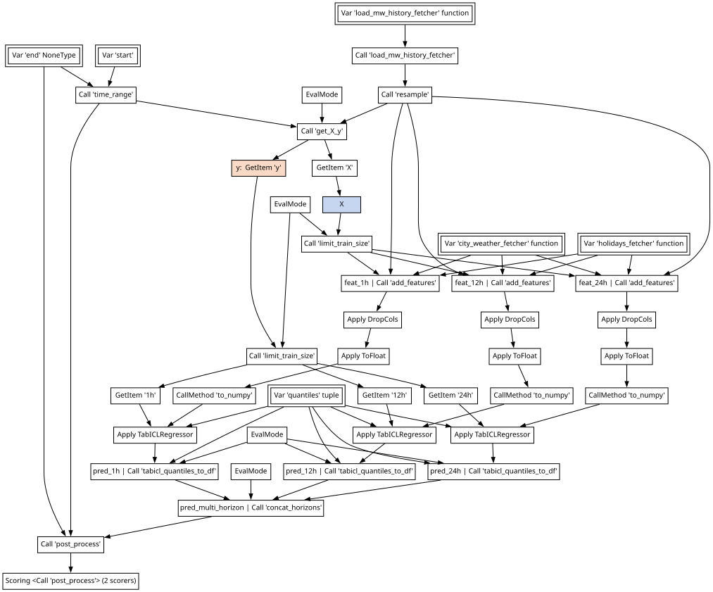
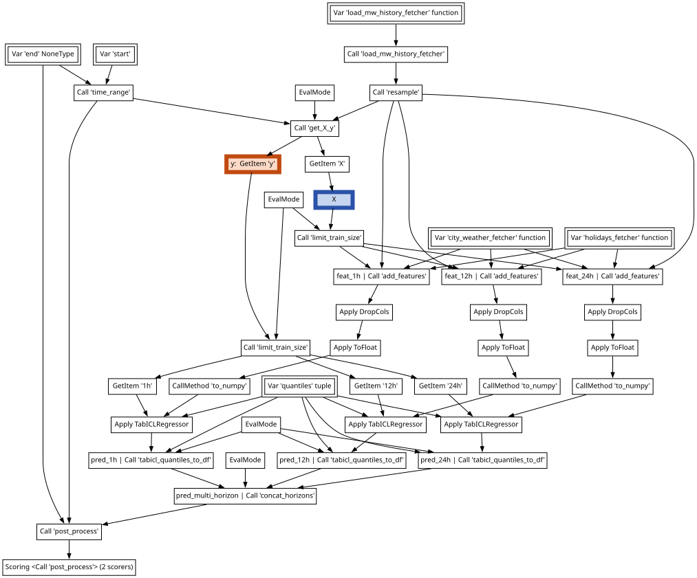
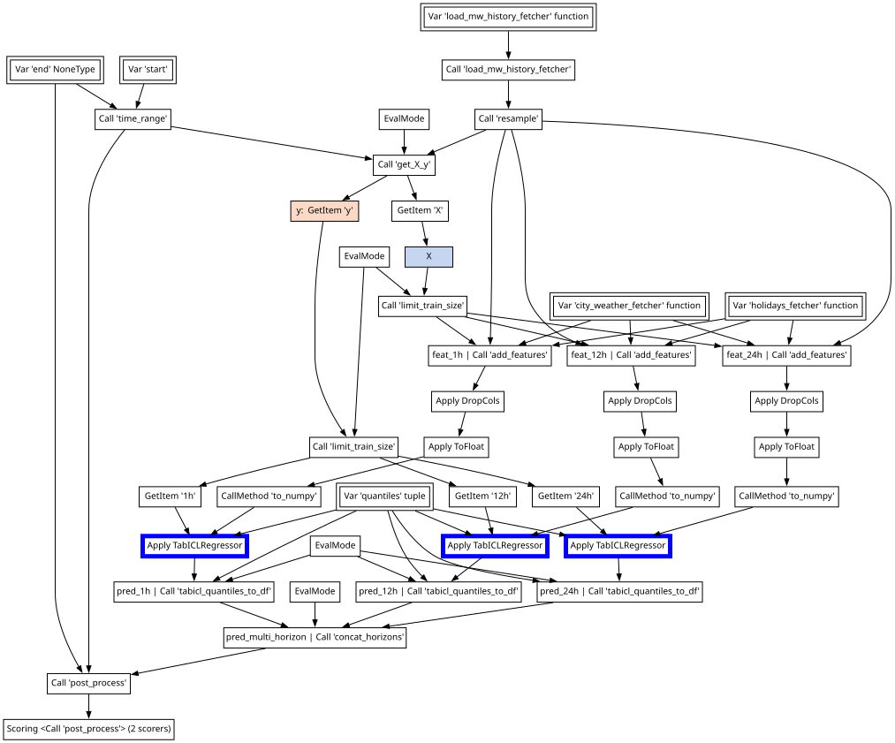
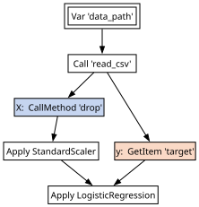
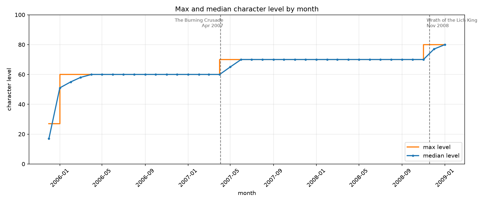
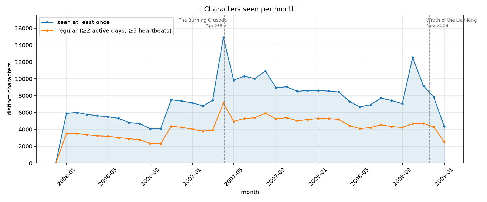

## Skrub {.smaller}

Machine learning on tabular data

{width="70%" style="margin-bottom: -1rem;"}

{width="60%" style="margin-bottom: -1rem;"}

::: {.incremental}
- [skrub-data.org](https://skrub-data.org)
- This talk: the [skrub DataOps](https://skrub-data.org/stable/data_ops.html) framework.
:::

# Act 1: skrub Data Ops

## {.smaller}

:::: {.columns}

::: {.column width="44%"}

**Textbook ML**

<br>

$X \in \mathbb{R}^{n \times p},\ y \in \mathbb{R}^n$

$\hat{y} = f_{\hat{\theta}}(X)$

<br>

```{=html}
<pre><code class="language-python">estimator = <span style="outline: 3px transparent; outline-offset: 1px;">TabICLRegressor()</span>

cross_validate(estimator, X, y)

estimator.fit(X_train, y_train)
estimator.predict(X_new)</code></pre>
```
:::

::: {.column width="55%"}
**Data-Science Practice**


:::

::::

## {.smaller}

:::: {.columns}

::: {.column width="44%"}

**Textbook ML**

<br>

$X \in \mathbb{R}^{n \times p},\ y \in \mathbb{R}^n$

$\hat{y} = f_{\hat{\theta}}(X)$

<br>

```{=html}
<pre><code class="language-python">estimator = TabICLRegressor()

cross_validate(estimator, <span style="outline: 3px solid #2a52a8; outline-offset: 1px;">X</span>, <span style="outline: 3px solid #c04a10; outline-offset: 1px;">y</span>)

estimator.fit(X_train, y_train)
estimator.predict(X_new)</code></pre>
```
:::

::: {.column width="55%"}
**Data-Science Practice**


:::

::::

## {.smaller}

:::: {.columns}

::: {.column width="44%"}

**Textbook ML**

<br>

$X \in \mathbb{R}^{n \times p},\ y \in \mathbb{R}^n$

$\hat{y} = f_{\hat{\theta}}(X)$

<br>

```{=html}
<pre><code class="language-python">estimator = <span style="outline: 3px solid blue; outline-offset: 1px;">TabICLRegressor()</span>

cross_validate(estimator, X, y)

estimator.fit(X_train, y_train)
estimator.predict(X_new)</code></pre>
```
:::

::: {.column width="55%"}
**Data-Science Practice**


:::

::::


## 
To build a ML pipeline, we need to:

- preprocess the data, perform feature engineering, train a model ... 
- so we need to [**learn a state**]{style="color: #1a5a8a; font-weight: bold;"}... 
- while we [**evaluate the predictive performance**]{style="color: #1a5a8a; font-weight: bold;"}... 
- as we avoid [**data leakage**]{style="color: #1a5a8a; font-weight: bold;"}... 
- with multi-source input ... 

How do we deal with that? 

## With Data Ops... {.smaller}

**Data wrangling:** filtering, resampling, aggregations, joins, ...

- Cross-validate without [**data leaks**]{style="color: #1a5a8a; font-weight: bold;"}.
- [**Tune choices**]{style="color: #1a5a8a; font-weight: bold;"} with validation scores.
- Replay on [**new inputs**]{style="color: #1a5a8a; font-weight: bold;"}.

::: {.callout-note icon=false style="font-size: 1em;"}
### DataOps

- All the goodies of the scikit-learn framework: `fit()` & `predict()`, cross-validation, hyperparameter tuning, serialization.
- Without the usual restrictions & while supporting **arbitrary data processing**.
  [Multiple inputs, feature & target construction, filtering samples, dynamic arguments for CV splitters & scorers, etc.]{style="font-size: 0.8em; color: gray;"}
- And more: Optuna integration, dynamic previews, pipeline inspection, ...
:::

## Basic example {.smaller auto-animate="true"}


::: {.columns}

::: {.column width=60%}


::: {.fragment fragment-index=1}

Declare the pipeline

```{.python code-line-numbers="|1|2|3,4|5-7|"}
data_path = skrub.var("data_path")
data = data_path.skb.apply_func(pd.read_csv)
X = data.drop(columns="target", errors="ignore").skb.mark_as_X()
y = data["target"].skb.mark_as_y()
pred = X.skb.apply(
    StandardScaler()
).skb.apply(LogisticRegression(), y=y)
```


:::


::: {.fragment}

Cross-validate

```{.python code-line-numbers="|2|"}
pred.skb.cross_validate(
    environment={"data_path": "historical_data.csv"}
)
```

:::


::: {.fragment}


Make a "learner" (object with `fit()` & `predict()`)

```{.python code-line-numbers="|2|3|5|6|"}
learner = pred.skb.make_learner(
).fit(
    environment={"data_path": "historical_data.csv"}
)
learner.predict(
    environment={"data_path": "new_data.csv"}
)
```


:::


:::

::: {.column width=40%}


::: {.fragment fragment-index=2}



:::


:::

:::


# Act 2: Dataset and problem

## The game {.smaller}

::: {.columns}

::: {.column}

- World of Warcraft (WoW) is a **subscription-based** MMORPG released in 2004 by
Blizzard Entertainment. 
- In WoW, players chreate **character avatars** to navigate the open game world
and perform various activities. 
- Players level up their caracters to make them more powerful. 
- Player characters belong to a **faction** (Alliance or Horde), have a **race** 
and a **class**.

:::

::: {.column}


:::

:::

## The problem {.smaller}
- Since WoW is subscription-based, players pay a monthly fee to play the game. 
- Some players eventually stop playing, and thus stop paying their subscription.

::: {.callout}

We want to predict which players are likely to churn in the next month, in
order to enact some measure to keep them from leaving. 

A player **churns** if they have **no activity** for two full months. 

:::


::: {.fragment}

- Our "unit of analysis" is a (player character, month) pair. 
- Each pair tells us whether the given player character played on the given month.


:::


## The dataset {.smaller}


::: {.columns}

::: {.column}


- **Dataset**: World of Warcraft Avatar history Dataset [^1]
- ~35.6M timestamped "character is active" lines (**heartbeats**). 
- Heartbeats are stored in txt files, grouped by day and quarter. 
- Time range: 2005-12-31 / 2009-01-10 in the 
**Taiwanese server**.
- Two expansions are included in the range:
  - The Burning Crusade (April 3, 2007)
  - Wrath of the Lich King (November 18, 2008).  


:::

::: {.column}


```
# cut output of tree WoWAH
WoWAH
├── 2006_01_03
│   ├── 2006-01-01
│   │   ├── 00-03-56.txt
│   │   ├── 00-13-43.txt
│   │   ├── 00-23-48.txt
│   │   ├── 00-33-48.txt
│   │   ├── ...
│   ├── 2006-01-02
│   ├── ...
├── 2006_04_06
├── ...
```

:::

:::

[^1]: [Source](https://web.cs.wpi.edu/~claypool/mmsys-dataset/2011/wow/)


## The dataset {.smaller}


::: {.columns}

::: {.column}

- Training samples are plain text, with custom formatting.
- A custom parser must be used to convert the samples and extract the correct dtypes.


:::

::: {.column}

```
# head WoWAH/2006_01_03/2006-01-01/00-03-56.txt 
Persistent_Storage = {
	[1] = "0, 12/31/05 23:59:46, 1,0, , 5, Orc, Warrior, Durotar, no, 0",
	[2] = "0, 12/31/05 23:59:46, 1,1, , 9, Orc, Shaman, Durotar, yes, 0",
	[3] = "0, 12/31/05 23:59:52, 2,2, , 13, Orc, Shaman, Durotar, no, 0",
	[4] = "0, 12/31/05 23:59:52, 2,3,0, 14, Orc, Warrior, Durotar, no, 0",
	[5] = "0, 12/31/05 23:59:52, 2,4, , 14, Orc, Shaman, Durotar, yes, 0",
	[6] = "0, 12/31/05 23:59:52, 2,5, , 16, Orc, Hunter, The Barrens, yes, 0",
	[7] = "0, 12/31/05 23:59:52, 2,6, , 18, Orc, Warlock, The Barrens, no, 0",
	[8] = "0, 12/31/05 23:59:52, 2,7, , 17, Orc, Hunter, Silverpine Forest, yes, 0",

```


:::

:::

## The datasets: some statistics {.smaller}




## The datasets: some statistics {.smaller auto-animate="true"}


## The dataset: `TableReport`


## Feature engineering {.smaller}

- Session-based features (`skrub.SessionEncoder`)
  - Number of sessions, duration, distribution during the day... 
- Monthly aggregates 
  - Statistics by class, race, overall playerbase...
- Location-based features
  - Zone rarity, where players spend their time
- Lagged features 
- `skrub.TableVectorizer` to encode 

More detail about feature engineering and model selection is available in the full technical report. 

## Model selection

- `HistGradientBoostingClassifier` as the evaluation model
- Month-by-month temporal CV
- Hyperparameter tuning with Data Ops and Optuna

::: {.callout-important}

Model optimization is intentionally **not the focus** of this talk. 

:::


## Caveats
- While we are interested in **players**, we have information only about their 
**avatars**. A player may stop playing with an avatar, but keep paying the subscription. 
- As this is past data, we cannot actually evaluate the effectiveness of whatever
measure we decide to implement, so we can only try to **predict player behavior**. 


# Act 3: The implementation

## Pain point 1 - Data ingestion is part of the pipeline {.smaller}


::: {.columns}

::: {.column}
- Data is not in a clean format:
  - Heartbeats are in text files scattered over hundreds of folders
  - Logs need to be resampled to have (character, month) granularity
- The same transformations (and all other **learned states**) need to be replayed
on new data. 
- Glue code and pre-processing scripts are brittle and prone to errors.

:::

::: {.column}


```{.python code-line-numbers="|3-4,9-11|6-7,13-14"}
import skrub

def draft_loader():
  return pd.read_csv("path/to/file.csv")

def prod_loader():
  return api.fetch().to_pandas()

loader = skrub.var("loader", draft_loader, becomes_default=True)
# build the DAG  
learner = data_op.skb.make_learner(fitted=True)

# Use a different loader to get production data
learner.predict({"loader": prod_loader})

# No changes needed by the learner!

```

:::

:::


## Pain point 1 - Data preparation is part of the pipeline {.smaller}

In our Data Op plan:

1. The input dataset is a list of plaintext files
2. The pipeline reads each file, removes bloat lines, parses each heartbeat
3. Heartbeats are converted to a polars lazyframe to serve as `historical` for
the rest of the pipeline
4. Builds the churn dataset by aggregating the available data over player character
 and month

The target is built **inside** of the pipeline. 


## Pain point 2 — Leakage in temporal feature engineering {.smaller}

- Features must only use data available at scoring time
- Session detection and aggregations are **stateful w.r.t. time**: doing them once on the full table leaks the future
- sklearn `Pipeline` cannot do this: `X`/`y` must exist **before** the pipeline starts, and wrangling lives outside
- we are performing aggregations over different, time-aware splits
- In the example: `X` and `y` are cut **inside** the plan (`mark_as_X` / `mark_as_y`), so each CV fold re-runs the feature code on training data only

::: {.notes}
This is the central difficulty of the example (`main.py:90-186`). If the target month is April, features may only be built from February data and earlier (`main.py:136-143`). The skrub sessionization doc (`modules/multi_column_operations/sessionization.rst`) carries a warning box saying aggregation leaks unless it is re-fit per fold — either wrapped in an sklearn transformer or done "with the skrub Data Ops framework". DataOps bind the whole wrangling DAG to the prediction, so `skb.cross_validate()` re-executes the leakage-safe steps inside every fold automatically, instead of the user hand-rolling fold-by-fold feature construction.
:::

## Pain point 2 — Cross-validation with irregular time splits {.smaller auto-animate="true"}


## Pain point 2 — Cross-validation with irregular time splits {.smaller auto-animate="true"}


::: {.columns}

::: {.column}

- Off-the-shelf `TimeSeriesSplit` assumes folds of **equal size**
- Here the number of (character, month) rows **grows every month** — folds are unbalanced by nature

:::

::: {.column}


:::

:::

## Pain point 2 — Cross-validation with irregular time splits {.smaller auto-animate="true"}


::: {.columns}

::: {.column width=40%}


- Write a **custom splitter** that uses custom dataframe logic to select the samples
- With DataOps plug it in `skb.mark_as_X(cv=Splitter())`
- Now, the splitter is honored by `cross_validate`, `train_test_split`, randomized search, and scoring

:::

::: {.column width=60%}


```{.python}
class Splitter:
    def split(self, X, y=None):
        ...
        for split_point in ...:
            test_month = pl.Series([split_point]).dt.offset_by("1mo").first()
            train_idx = (
                X.with_row_index("idx")
                .filter(pl.col("month") <= split_point)["idx"]
            )
            test_idx = (
                X.with_row_index("idx")
                .filter(pl.col("month") == test_month)["idx"]
            )
```

:::

:::


## Pain point 3 — Tuning wrangling choices, not just model knobs {.smaller}

- Model choices are not limited to model hyperparameters: `session_gap` (15/30/60 min), include location features?, add Gini?, which lags?
- These are **data pipeline decisions**, with big performance and runtime impact
- **With DataOps** choices can be dropped inline, where the value is used — `choose_from`, `choose_bool`, `choose_float(log=True)`
- One call to `skb.make_randomized_search(backend="optuna", ...)` turns the whole DAG into a search 

## Pain point 3 — Tuning wrangling choices, not just model knobs {.smaller}
```{=html}
<ul style="font-size: 0.8em;">
<li>Replace any value with a choice:</li>
</ul>
<pre style="font-size: 0.55em; background-color: #f5f5f5; padding: 0.6em 1em; margin: 0.8em 0;"><code style="background-color: inherit;"> X = data.drop(columns="target", errors="ignore").skb.mark_as_X()
 y = data["target"].skb.mark_as_y()
 pred = X.skb.apply(StandardScaler()).skb.apply(
<span style="color: #c00; background-color: #fff0f0;">-    LogisticRegression(<span style="background-color: #f9a0a0;">C=1.0</span>),</span>
<span style="color: #080; background-color: #f0fff0;">+    LogisticRegression(<span style="background-color: #9be99b;">C=skrub.choose_float(0.1, 10.0, log=True)</span>),</span>
     y=y)</code></pre>
<ul style="font-size: 0.8em;">
<li>Use grid search or randomized search (possibly backed by Optuna).</li>
</ul>
<pre style="font-size: 0.55em; background-color: #f5f5f5; padding: 0.6em 1em; margin: 0.8em 0;"><code style="background-color: inherit;"><span style="color: #c00; background-color: #fff0f0;">-learner = pred.skb.<span style="background-color: #f9a0a0;">make_learner</span>().fit({...})</span>
<span style="color: #080; background-color: #f0fff0;">+learner = pred.skb.<span style="background-color: #9be99b;">make_randomized_search</span>().fit({...})</span></code></pre>
<ul style="font-size: 0.8em;">
<li>Tune data pipeline decisions, not only hyperparameters</li>
</ul>
<pre style="font-size: 0.55em; background-color: #f5f5f5; padding: 0.6em 1em; margin: 0.8em 0;"><code style="background-color: inherit;">X_enc = X.skb.apply_func(build_features,
<span style="color: #080; background-color: #f0fff0;">+  additional_features=<span style="background-color: #9be99b;">skrub.choose_bool()</span></span>
 )
 pred = X.skb.apply(LogisticRegression())</code></pre>
```

## Pain point 5 — Debugging a complex DAG

- Data Ops work **lazily**: they need to evaluate all nodes in the DAG to run
- Eager **previews**: pass a value to `var()` and every node shows its result immediately
- `skb.report()` emits an HTML report: every node's name, description, predecessors, fitted estimator, and **data preview**
- On failure, the report shows the offending node and the traceback

## Pain point 5 - Debugging a complex DAG

<iframe src="reports/execution_report/index.html" width="100%" height="480px" style="border: 1px solid #ccc; border-radius: 4px;"> </iframe>

## Pain point 7 — Stay in your dataframe API inside the plan {.smaller}

- Frameworks usually force you to leave Polars once you enter "pipeline land"
- DataOps are **transparent**: Polars methods are called directly on DataOps (`historical_data.with_columns(...)`, `.collect()`, indexing, joins)
- Python control flow (`for month in ...`) must be put in `@deferred` / `apply_func` functions
- Deferred functions appear as **one graph node** — good for reports and caching 
